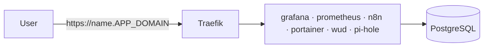

# ☁️ CloudOps-Sandbox

A local cloud lab on Docker Compose: one Traefik entry point, one PostgreSQL
server, and one folder per tool. No scripts — every step is a command you can
read and run.



## Stacks

| Stack | URL |
| :--- | :--- |
| `traefik` | `https://traefik.<APP_DOMAIN>` |
| `pgsql` | internal only |
| `prometheus` | `https://prometheus.<APP_DOMAIN>` |
| `grafana` | `https://grafana.<APP_DOMAIN>` |
| `n8n` | `https://n8n.<APP_DOMAIN>` |
| `portainer` | `https://portainer.<APP_DOMAIN>` |
| `wud` | `https://wud.<APP_DOMAIN>` |
| `pi-hole` | `https://pihole.<APP_DOMAIN>/admin/` |
| `cloudflared` | Cloudflare Tunnel, optional — [Mode D](docs/access-modes.md#mode-d-cloudflare-tunnel) |

`make up` starts the stacks on the `STACKS` line of the `Makefile` (all of
the above except `cloudflared`).

Needs: macOS or Linux, Docker with `docker compose`, `git`, `make`, `openssl`.

## Quick start

**1. Configure**

```bash
git clone https://github.com/chinmaymjog/cloudops-sandbox.git
cd cloudops-sandbox
cp .env.template .env
```

Replace every `TODO` in `.env` with its own `openssl rand -hex 16`.
`grep TODO .env` should print nothing.

**2. Create the databases** (once)

```bash
make up STACKS=pgsql
until docker exec postgresql pg_isready -h localhost -U postgres; do sleep 1; done
set -a; source .env; set +a

docker exec postgresql psql -U postgres \
  -c "CREATE USER n8n WITH PASSWORD '$N8N_DB_PASSWORD';" \
  -c "CREATE DATABASE n8n OWNER n8n;"

docker exec postgresql psql -U postgres \
  -c "CREATE USER grafana WITH PASSWORD '$GRAFANA_DB_PASSWORD';" \
  -c "CREATE DATABASE grafana OWNER grafana;"
```

**3. Start**

```bash
make up
make status
```

Open `https://grafana.127.0.0.1.nip.io` (and the other URLs above). The
certificate warning is expected with nip.io.

- WUD and Pi-hole return `404` for ~30 seconds, until their first health check passes.
- n8n or Grafana stuck `Restarting` with `password authentication failed` in `docker logs`: step 2 was skipped. Run it; they recover on their own.

Remote VM or your own domain: [docs/access-modes.md](docs/access-modes.md).

## Add a service

**1.** Copy the starter:

```bash
cp -r template stacks/myapp
```

In `stacks/myapp/docker-compose.yml`, replace `myapp` with your service's
name, then set its image and the port it listens on. As-is, it runs
`traefik/whoami`.

**2.** Add its values to `.env` (and to `.env.template`, with `TODO` for secrets):

```dotenv
# --- myapp
MYAPP_TAG=v1.11.0
```

**3.** Only if it uses PostgreSQL — add `MYAPP_DB_PASSWORD` to `.env`, then:

```bash
set -a; source .env; set +a
docker exec postgresql psql -U postgres \
  -c "CREATE USER myapp WITH PASSWORD '$MYAPP_DB_PASSWORD';" \
  -c "CREATE DATABASE myapp OWNER myapp;"
```

**4.** Add `myapp` to `STACKS` in the `Makefile`, then:

```bash
make up
curl -k https://myapp.127.0.0.1.nip.io
```

To remove it:

```bash
docker compose --env-file .env -f stacks/myapp/docker-compose.yml down
docker exec postgresql psql -U postgres -c "DROP DATABASE myapp;" -c "DROP USER myapp;"   # if it had one
```

Then delete `stacks/myapp/` and take it off `STACKS`.

## Commands

```bash
make up                  # start the STACKS list
make up STACKS=n8n       # start or update one stack
make down                # stop everything (data is kept)
make status              # running containers
docker logs -f <name>    # one container's logs
```

After changing a `docker-compose.yml` or `.env`, run `make up` again.

Start over (deletes all data):

```bash
make down
docker volume rm -f pgsql-data grafana-data n8n-data portainer-data prometheus-data pihole-data traefik-log traefik-certs
```

## Pi-hole as your network's DNS

Port 53 isn't published by default (it's often taken on the host). To use it:
uncomment `ports:` in `stacks/pi-hole/docker-compose.yml`, run
`make up STACKS=pi-hole`, check with `nslookup doubleclick.net 127.0.0.1`
(blocked = `0.0.0.0`), then point your devices' DNS at this machine. If port 53
is in use on Ubuntu/Fedora, see
[Disable systemd-resolved port 53](https://docs.pi-hole.net/docker/tips-and-tricks/#disable-systemd-resolved-port-53).

---
*Maintained by [Chinmay Jog](https://github.com/chinmaymjog) | 📖 [Read my articles on Medium](https://medium.com/@chinmaymjog)*
