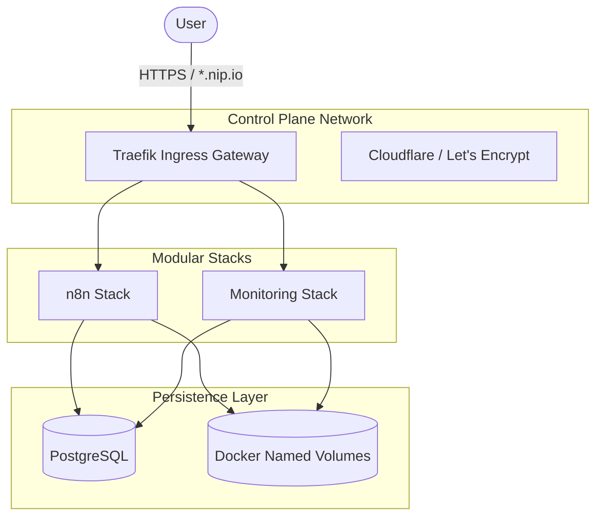

# ☁️ CloudOps-Sandbox
## A Production-Grade Local Cloud Architecture

A modular infrastructure sandbox for testing cloud-native stacks, observability, and automation tools on your laptop or a remote VM.

> [!TIP]
> Every stack is a plain Docker Compose file. Nothing is generated or hidden:
> you copy one `.env`, run a few commands, and `make up`.

## 🏗️ Architecture: The "Local Cloud" Design

Traefik is the single entry point, every tool lives in its own stack, and
they all share one Docker network (`control-plane`) and one PostgreSQL server.



## 🏗️ Stacks

Each folder under `stacks/` is one stack: a `docker-compose.yml` (plus a
`conf/` folder where the tool needs a config file). All of them read their
values from the one root `.env`.

| Stack | URL | What it is |
| :--- | :--- | :--- |
| `traefik` | `https://traefik.<APP_DOMAIN>` | Ingress and TLS for everything else |
| `pgsql` | — (internal only) | Shared PostgreSQL server |
| `prometheus` | `https://prometheus.<APP_DOMAIN>` | Metrics |
| `grafana` | `https://grafana.<APP_DOMAIN>` | Dashboards (stores its data in PostgreSQL) |
| `n8n` | `https://n8n.<APP_DOMAIN>` | Workflow automation (stores its data in PostgreSQL) |

`make up` starts the stacks named on the `STACKS` line of the `Makefile`
(all of the above).

Want Portainer/WUD, or a Cloudflare Tunnel for public access without
port-forwarding? Check out the [`advanced`
branch](https://github.com/chinmaymjog/cloudops-sandbox/tree/advanced) - the
same lab and the same flow, with more stacks.

## 📋 Prerequisites

- macOS or Linux
- Docker Desktop (Mac) or Docker Engine (Linux), with `docker compose`
- `git`, `make`, `openssl`
- A modern `x86_64` or `arm64` CPU

## 🛠️ Quick Start

### 1. Get the code

```bash
git clone https://github.com/chinmaymjog/cloudops-sandbox.git
cd cloudops-sandbox
```

Fork first if you want to keep your own changes.

### 2. Create `.env`

```bash
cp .env.template .env
```

Replace each placeholder in `.env` with its own random value:

| Variable | Generate with |
| :--- | :--- |
| `POSTGRES_PASSWORD` | `openssl rand -hex 16` |
| `N8N_DB_PASSWORD` | `openssl rand -hex 16` |
| `GRAFANA_DB_PASSWORD` | `openssl rand -hex 16` |
| `GRAFANA_ADMIN_PASSWORD` | `openssl rand -hex 16` |
| `N8N_ENCRYPTION_KEY` | `openssl rand -hex 32` |

`APP_DOMAIN=127.0.0.1.nip.io` works as-is on a laptop. For a remote VM or
your own domain, see [Access Modes](docs/access-modes.md).

> [!IMPORTANT]
> `GRAFANA_ADMIN_PASSWORD` only takes effect on Grafana's first boot. Set it
> before your first `make up`. To change it later:
> `docker exec grafana grafana-cli admin reset-admin-password <new-password>`.

### 3. Start PostgreSQL and create the app databases

n8n and Grafana each need their own database and user. Start PostgreSQL on
its own, wait until it accepts connections, then create them:

```bash
make up STACKS=pgsql
until docker exec postgresql pg_isready -h localhost -U postgres; do sleep 1; done

set -a; source .env; set +a   # load the passwords from .env into this shell

docker exec postgresql psql -U postgres \
  -c "CREATE USER n8n WITH PASSWORD '$N8N_DB_PASSWORD';" \
  -c "CREATE DATABASE n8n OWNER n8n;"

docker exec postgresql psql -U postgres \
  -c "CREATE USER grafana WITH PASSWORD '$GRAFANA_DB_PASSWORD';" \
  -c "CREATE DATABASE grafana OWNER grafana;"
```

You only do this once. The databases live in the `pgsql-data` volume and
survive `make down`.

### 4. Start everything

```bash
make up
make status
```

The first run takes a few minutes while Docker pulls images. Then open:

- `https://traefik.127.0.0.1.nip.io`
- `https://grafana.127.0.0.1.nip.io`
- `https://n8n.127.0.0.1.nip.io`

If n8n or Grafana shows `Restarting` and `docker logs <name>` says
`password authentication failed`, step 3 was skipped — run it, and the
container recovers on its own.

nip.io uses a self-signed certificate, so a browser warning is expected.
There is no login in front of the Traefik dashboard — don't expose the lab
outside a trusted network without adding access control in front of it.

## ➕ Add a Service

Four steps, using [`traefik/whoami`](https://github.com/traefik/whoami) as the
example. Swap in your own image, name and port.

### 1. Write the Compose file

`stacks/whoami/docker-compose.yml`:

```yaml
services:
  whoami:
    image: traefik/whoami:${WHOAMI_TAG}
    container_name: whoami
    restart: unless-stopped
    networks:
      - control-plane
    labels:
      - traefik.enable=true
      - traefik.http.routers.whoami.rule=Host(`whoami.${APP_DOMAIN}`)
      - traefik.http.routers.whoami.entrypoints=websecure
      - traefik.http.routers.whoami.tls=true
      - traefik.http.services.whoami.loadbalancer.server.port=80

networks:
  control-plane:
    external: true
```

- Every `${VAR}` comes from the root `.env`.
- The `traefik.*` labels give it `https://whoami.<APP_DOMAIN>`; change the
  `port=` to the port the app listens on inside the container.
- If it keeps data, add a named volume — copy the `volumes:` pattern from
  `stacks/n8n/docker-compose.yml`.

### 2. Add its values to `.env`

```dotenv
WHOAMI_TAG=v1.11.0
```

Need a password or key? Generate it with `openssl rand -hex 16` (or `-hex 32`)
and add it here too. If you're committing the stack, add the same variable
names with placeholder values to `.env.template`.

### 3. Create its database (only if it uses PostgreSQL)

Same commands as Quick Start step 3, with your app's name and password
variable:

```bash
set -a; source .env; set +a
docker exec postgresql psql -U postgres \
  -c "CREATE USER myapp WITH PASSWORD '$MYAPP_DB_PASSWORD';" \
  -c "CREATE DATABASE myapp OWNER myapp;"
```

Point the app at host `postgresql`, port `5432`, database and user `myapp`.

### 4. Start it

Add `whoami` to the end of the `STACKS` line in the `Makefile`, then:

```bash
make up
```

Or start just this one stack, without touching the Makefile:

```bash
make up STACKS=whoami
# same as: docker compose --env-file .env -f stacks/whoami/docker-compose.yml up -d
```

Check it:

```bash
docker logs --tail 50 whoami
curl -k https://whoami.127.0.0.1.nip.io
```

### Removing a service

```bash
docker compose --env-file .env -f stacks/whoami/docker-compose.yml down
```

Then delete `stacks/whoami/`, remove it from `STACKS`, and drop its
variables from `.env`. If it had a database:

```bash
docker exec postgresql psql -U postgres -c "DROP DATABASE myapp;" -c "DROP USER myapp;"
```

## 🧰 Everyday Commands

```bash
make up                  # start the stacks on the STACKS line
make up STACKS=n8n       # start (or recreate) one stack
make down                # stop every stack; data volumes are kept
make status              # running containers
docker logs -f <name>    # follow one container's logs
```

After editing a stack's `docker-compose.yml` or its values in `.env`, run
`make up` again — Compose recreates only what changed.

### Start over from scratch

This deletes all data:

```bash
make down
docker volume rm -f pgsql-data grafana-data n8n-data prometheus-data traefik-log traefik-certs
docker network rm control-plane
```

Then follow the Quick Start again from step 2.

---
*Maintained by [Chinmay Jog](https://github.com/chinmaymjog) | 📖 [Read my articles on Medium](https://medium.com/@chinmaymjog)*
